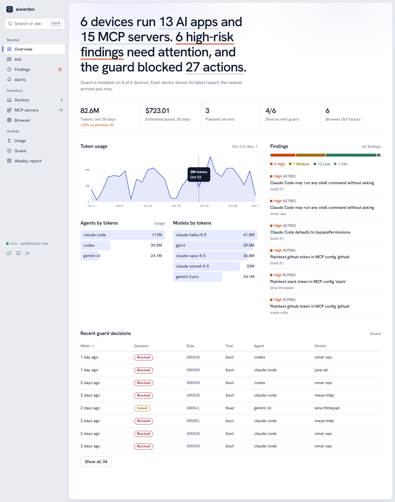
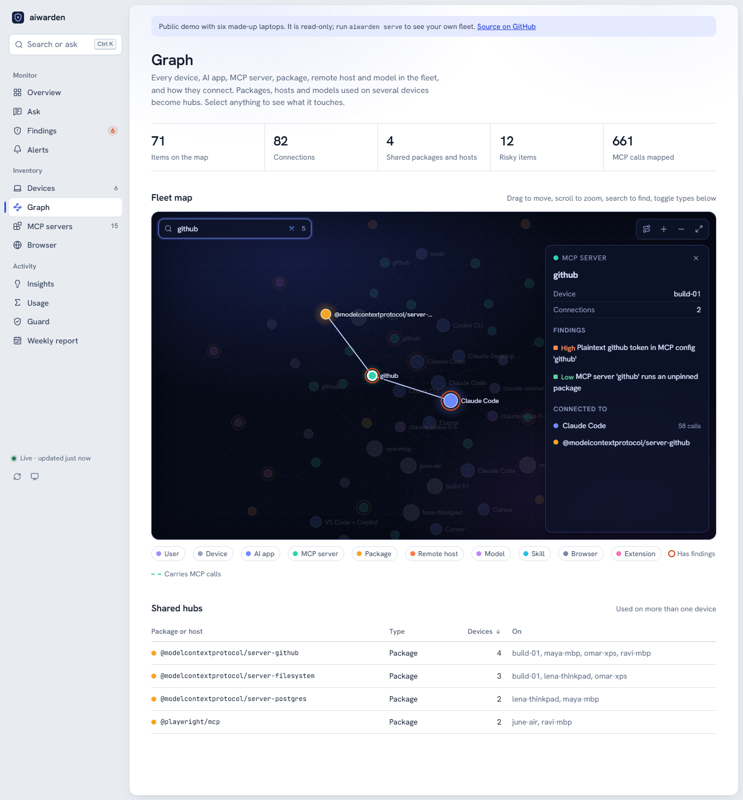
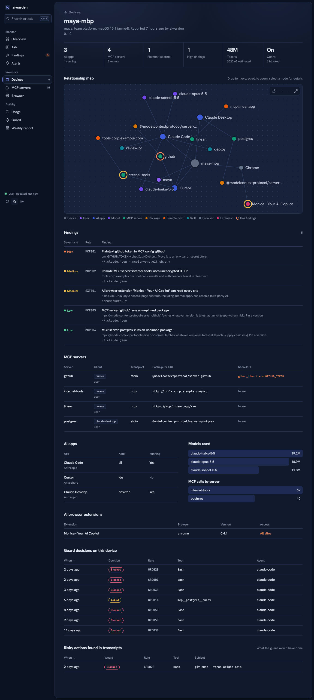

# aiwarden

Open-source endpoint visibility and guardrails for AI apps, coding agents and MCP servers.

AI tools now run on every developer laptop: Claude Code, Cursor, Codex, Gemini CLI, VS Code
extensions, browser extensions and local models. Each one wires itself to MCP servers, tokens
and data. Network gateways and EDRs don't see that layer. aiwarden runs on the endpoint, reads
what each app has configured and done, and can stop a risky agent action before it executes.

It is an open alternative to the commercial "CrowdStrike for AI agents" category. It is not
affiliated with any vendor in that category.

**Live demo: https://aiwarden-gamma.vercel.app**. Paste a command an agent ran and see whether the
guard would block it, browse a made-up six-laptop fleet, or open a report from your own machine in
the page (it is read in the browser tab, never uploaded).

## Quickstart

```
pipx install "git+https://github.com/twelfthlabor/open-yc.git#subdirectory=aiwarden"
aiwarden setup                  # scan, offer the guard for the agents found, write a monitor-mode policy
aiwarden serve --local          # web console for this machine: http://127.0.0.1:8765, no token
```

aiwarden is not on PyPI yet. The package is ready to publish, and once it is, the first line becomes
`pipx install aiwarden` (or run it without installing: `uvx aiwarden setup`). Plain `pip install` from
a clone works too (`git clone https://github.com/twelfthlabor/open-yc && pip install ./open-yc/aiwarden`).
Add `[proc]` for psutil-based process discovery. Installing needs no Node: the console is prebuilt.



`aiwarden setup` scans the device, lists the agents the guard can protect (Claude Code, Codex,
Gemini CLI), asks before installing the guard hook in them (`--yes` to skip the question,
`--no-hooks` to skip the hooks), and writes `~/.aiwarden/policy.toml` in monitor mode if you have
none, so the guard logs what it would block until you set `mode = "enforce"`. `--serve` starts the
console when it is done. The individual steps are also commands of their own:

```
aiwarden scan                   # inventory + posture findings + usage on this machine
aiwarden hooks install --agent all   # block destructive agent actions in Claude Code, Gemini CLI and Codex
aiwarden serve --local          # web console for this machine
```

## What it does

| | |
|---|---|
| **Discover** | AI apps installed or running (Claude Code/Desktop, Cursor, Windsurf, VS Code + Copilot/Cline/Roo/Continue, Codex, Gemini CLI, Zed, Antigravity, opencode, Ollama, LM Studio, ...). AI browser extensions in Chrome, Edge and Brave. Claude Code skills, plugins, hooks and permission mode. |
| **Map MCP** | Every MCP server configured in Claude Code (user, local, project `.mcp.json`), Claude Desktop, Cursor, Windsurf, VS Code (`mcp.json`, `settings.json`), Cline, Roo Code, Gemini CLI, Codex (`config.toml`) and Zed. Transport, package, remote host and env var names. |
| **Find risk** | Plaintext tokens in MCP configs, remote MCP over plain HTTP, unpinned `npx`/`uvx` packages, MCP servers given `/` or `C:\`, shell-exec servers, agents set to bypass approvals, AI extensions with access to every site. |
| **Measure use** | Tokens and estimated $ cost per agent, model, project, day, user and team, tool calls, and MCP calls per server, from Claude Code, Codex and Gemini CLI transcripts. It also replays past tool calls through the guard rules to show what *would* have been blocked. |
| **Ask** | `aiwarden ask "which teams' token usage doubled this month?"`: a deterministic query engine over one report or a whole collector, with an optional Claude translator for free-form questions. |
| **Alert and report** | `aiwarden alerts` (spend spikes, new MCP servers, new plaintext secrets, guard-block bursts, newly installed AI apps) to stdout, JSON or a Slack-compatible webhook. `aiwarden report weekly` writes Markdown or HTML. |
| **Scan MCP** | `aiwarden mcp-scan` flags known-risky MCP packages. When you let it connect, it also checks tool definitions for tool poisoning: hidden instructions, pointers at credential files, exfiltration URLs, invisible Unicode, cross-tool shadowing and broad capabilities. |
| **Prevent** | Pre-tool hooks for Claude Code (`PreToolUse`), Gemini CLI (`BeforeTool`) and Codex (`PreToolUse`) that block (Claude Code can also ask) before an agent runs `rm -rf ~`, `DROP DATABASE`, `git push --force origin main` or `curl … \| sh`, reads `~/.ssh/id_*`, or writes an API key into source. |
| **Browser DLP** | A Chrome/Edge extension (`extension/`) warns or blocks before secrets, card numbers, SSNs/SINs, bulk emails or customer lists are typed, pasted, dropped or uploaded into ChatGPT, Claude, Gemini, Copilot, Perplexity, DeepSeek and other AI chat sites, and records which AI sites are used and for how long. |
| **Graph** | One graph per device connects user, device, apps, MCP servers, packages, remote hosts, models, skills and extensions, with findings attached to the nodes they concern. |
| **Fleet** | `aiwarden push` sends the report to a self-hosted collector (`aiwarden serve`). The web console shows devices, findings, MCP packages across the fleet, token usage, guard decisions, alerts and the weekly report. |

## Privacy model

- Metadata only by default. Prompts, responses and command text are not stored or sent.
- Secret values are never stored. Findings carry the credential type and a short redacted
  prefix (`ghp_QQ…(40 chars)`).
- `--include-content` keeps the command or path behind each risky event, with secrets
  scrubbed. Use it locally when investigating.
- Everything runs locally. Data leaves the machine only when you run `aiwarden push` to a
  collector you host.

## Guard rules

Pre-tool hooks in Claude Code, Gemini CLI and Codex check each tool call before it runs. The 14
built-in rules (`aiwarden rules` lists them) cover recursive deletes of `/`, `~` or drive roots,
disk wipes, `DROP DATABASE` and other destructive SQL, force-pushes to protected branches,
`curl … | sh`, reading SSH keys and cloud credentials, `.env` reads, secrets written into files or
commands, uploads of local files to remote hosts, and agents editing their own guard config. Each
rule denies or asks by default. The full table, and what the guard does and does not catch, are in
[the reference](https://github.com/twelfthlabor/open-yc/blob/main/aiwarden/docs/REFERENCE.md#guard-rules).

Tune them in `~/.aiwarden/policy.toml` (`aiwarden policy init` writes a template, and `aiwarden setup`
writes one in monitor mode). You can override any rule, add regex rules, allowlist commands, or set
`mode = "monitor"` to log without blocking while you roll out.

Try a rule without running an agent (or in the [live demo](https://aiwarden-gamma.vercel.app)):

```
aiwarden check Bash "git push --force origin main"
{"action": "deny", "rule": "GRD020", "reason": "Force-push to a protected branch", "would_be": null}
```

The guard is a guardrail, not a sandbox: it uses static analysis of the tool input, and someone
deliberately obfuscating a command can get past it. If the guard itself errors, it lets the call
through, so a bug in aiwarden never stops your agent.

Gemini CLI and Codex hooks cannot ask the user, so an `ask` rule falls back to `ask_fallback`
(`"deny"` by default), and Codex runs a hook only after you trust it with `/hooks`. How each agent's
hook answers, and the tool names aiwarden maps, are in
[Gemini CLI and Codex](https://github.com/twelfthlabor/open-yc/blob/main/aiwarden/docs/REFERENCE.md#gemini-cli-and-codex).

## Browser extension

`extension/` is a Manifest V3 extension for Chrome and Edge, with no build step (load it with
**Load unpacked** at `chrome://extensions`). On the major AI chat sites it warns or blocks before
API keys, private keys, card numbers, SSNs/SINs, bulk emails or customer-list tables are sent,
pasted, dropped or uploaded. Events hold metadata only. Details: [the reference](https://github.com/twelfthlabor/open-yc/blob/main/aiwarden/docs/REFERENCE.md#browser-extension)
and [extension/README.md](https://github.com/twelfthlabor/open-yc/blob/main/aiwarden/extension/README.md).

## Teams

Map users and devices to teams in `~/.aiwarden/config.toml` on each device. Alternatively,
keep one mapping file and pass it to the analysis commands with `--teams FILE`:

```toml
team = "platform"                 # this device's team, written into the report's device block

[teams]                           # first match wins: device:<id>, host:<hostname>, or a user name
platform = ["alice", "host:build-01"]
data = ["bob", "device:3f2a9c51d0e4b7a2"]
```

`ask`, `alerts` and `report weekly` work out each report's team in this order:
1. the `[teams]` mapping file
2. the report's own `device.team`
3. `team` in the config

This lets you slice usage, cost and findings by team, user or app.

## Cost

aiwarden prices token counts from a table in `src/aiwarden/pricing.py`. The table is dated
(`PRICES_AS_OF`) and must be updated by hand when list prices change.
- Prices for current Anthropic models come from Anthropic's model table, as cached on
  2026-10-06.
- Prices for older Claude models (Sonnet 4.5, Opus 4.1 and others), OpenAI and Google were
  not checked against the providers' pricing pages. They are marked unverified, and
  `aiwarden usage` says so.
- A model with no price is listed as unpriced. Its cost is not guessed.

Override or add prices in `config.toml`:

```toml
[prices."claude-sonnet-4-5"]
input = 3.0          # USD per million tokens
output = 15.0
cache_read = 0.30    # default 0.1 x input
cache_write = 3.75   # default 1.25 x input
```

The estimate is what the usage would cost at API list prices. It ignores subscriptions
(Claude Max, ChatGPT plans), batch discounts and long-context surcharges. Reports carry
`cost_usd` per model, app, day and session, plus a total in `summary.cost_usd`.

## Asking questions

```
aiwarden ask "which teams' token usage doubled this month?" --server https://aiwarden.internal:8765 --token T
aiwarden ask "which Claude Code sessions called the github MCP?"          # this device
aiwarden ask "top 5 users by cost in the last 30 days" --report fleet.json
aiwarden ask --query '{"entity": "usage", "metric": "cost_usd", "group_by": ["team", "app"], "window": {"preset": "last_month"}}'
```

A small parser recognises a fixed set of question patterns (`aiwarden ask --help` lists
them). It turns each question into a structured query with an entity, metric, filters,
group_by, time window and comparison, and the engine runs that query over the reports.
Supported entities are usage, sessions, MCP calls, findings, apps, MCP servers, guard events
and risky events. With `--server`, aiwarden reads `/api/fleet` and then `/api/devices/<id>` for
each device.

If `ANTHROPIC_API_KEY` is set and the parser doesn't recognise a question, aiwarden sends it
to Claude (`claude-sonnet-5-5`, over the Messages API) with today's date and the query schema.
Claude returns a structured query, which aiwarden validates and runs locally. No report
content is sent: no hostnames, users, MCP names or numbers. `--llm` tries Claude first, and
`--no-llm` never calls it.

Limits:
- Each report keeps only the latest 200 sessions, so session questions over long periods can
  undercount. Daily token and cost series are complete.
- Inventory entities (apps, findings, MCP servers) come from the latest report per device and
  ignore time windows.

## Alerts and the weekly report

```
aiwarden alerts --server URL --token T --webhook https://hooks.slack.com/services/…
aiwarden report weekly --server URL --token T --format html --out weekly.html
```

Six alert rules fire on token and spend spikes, new MCP servers, new plaintext secrets, guard-block
bursts and newly installed AI apps, to stdout, JSON or a Slack-compatible webhook. Each alert fires
once. The rule table, thresholds and cron / Task Scheduler examples are in
[the reference](https://github.com/twelfthlabor/open-yc/blob/main/aiwarden/docs/REFERENCE.md#alerts-and-the-weekly-report).

## MCP security scan

```
aiwarden mcp-scan                                   # configs only: known-risky packages; starts nothing
aiwarden mcp-scan --connect --name github --name docs
aiwarden mcp-scan --connect --all --yes             # every enabled server
aiwarden mcp-scan --tools-file tools.json           # a saved tools/list response
```

With `--connect`, aiwarden asks each server only for its tool list (no tool is ever called) and checks
the tool definitions for tool poisoning: hidden instructions, pointers at credential files,
exfiltration URLs, invisible Unicode, cross-tool shadowing and broad capabilities. Starting a stdio
server runs its code, so connect only to servers you would run anyway. The rules are in
[the reference](https://github.com/twelfthlabor/open-yc/blob/main/aiwarden/docs/REFERENCE.md#mcp-security-scan).

## Fleet mode

```
# collector (put it behind TLS if it leaves localhost)
AIWARDEN_TOKEN=change-me aiwarden serve --host 0.0.0.0 --port 8765

# each device, e.g. from cron / Task Scheduler
AIWARDEN_TOKEN=change-me aiwarden push --server https://aiwarden.internal:8765 --days 30
```

The collector is stdlib Python with SQLite. It keeps the last 20 reports per device. Every
API route needs the bearer token. Report contents come from endpoints, so the console renders
every value as text and the collector serves it with a strict Content-Security-Policy (no inline
scripts or styles, no third-party origins).

## Web console

**Live demo: https://aiwarden-gamma.vercel.app** (six made-up laptops, read-only). The demo opens with the guard
tester, and **Open your own report** shows the JSON from `aiwarden scan --json --out me.json` in the same
console. The file is read in the browser tab and never sent anywhere; Ask, Alerts and the weekly report need
the Python backend, so in that mode they point you to the local install.

`aiwarden serve --local` is the console for your own machine. It scans at startup, rescans every
five minutes (`--rescan-every`, or the refresh button), and needs no token: it listens on 127.0.0.1
only, answers only requests whose Host and Origin are its own page (so another web page cannot reach
it), and takes no uploads. A collector that other machines push to (`aiwarden serve`, or `--local`
with `--host 0.0.0.0`) always needs a token. It prints a link ending in `#token=...`; the token stays
in the URL fragment, which browsers never send to the server, and the console removes it from the
address bar after reading it.

| Page | What it shows |
|---|---|
| Overview | One sentence on the fleet's state, 30-day token trend, top findings, agents and models, recent guard decisions |
| Ask | Plain-English questions over the fleet (`aiwarden ask` in the browser), with the structured query it ran |
| Findings | Every finding, filterable by severity and text, linked to its device, with how to fix it and the command to run |
| Alerts | Everything the alert rules would raise right now |
| Graph | Every device's map merged into one live, searchable fleet graph (Obsidian-style: it blooms in, edges that carry MCP calls flow, an inspector explains the selected item), plus the packages and hosts several devices share |
| Insights | When agents work (weekday by hour, in your time zone), spend by project, the tools and MCP servers agents call, recent sessions, what the guard would have stopped, and each device's Claude Code hooks, plugins, subagents and skills |
| Devices / device | Per-device inventory and an interactive relationship map (drag, zoom, select) of apps, MCP servers, packages, hosts, models and skills, with an attack-path view from the user to each risky item |
| MCP servers | Servers grouped by package or URL across the fleet, and the tool-poisoning scan rules |
| Browser | AI sites used and what the extension's DLP caught |
| Usage | Daily input/output tokens, spend by agent, per-model table |
| Guard | Decisions, the rule catalogue with hit counts, and a tester that shows what the guard decides for a command (nothing is run) |
| Weekly report | The weekly report, printable |

Press Ctrl K (⌘K on a Mac) for the command menu. Light, dark and system themes are built in. The fleet data
behind the console refreshes every 30 seconds while the tab is visible; if the collector stops answering, the
console keeps the last data and says so. Page entrances, chart draw-ins and number count-ups turn off with
the OS "reduce motion" setting.

How this compares with the commercial product it is modeled on: [docs/PARITY.md](https://github.com/twelfthlabor/open-yc/blob/main/aiwarden/docs/PARITY.md).





The console adds these read-only routes (bearer token required): `GET /api/rules`,
`GET /api/weekly?as_of=`, `GET /api/alerts?as_of=`, `POST /api/ask` (`{"question": ...}` or
`{"query": {...}}`) and `POST /api/check` (`{"agent", "tool", "input"}`, dry run against the
built-in rules). Ask uses the local parser; set `AIWARDEN_ASK_LLM=1` and `ANTHROPIC_API_KEY` on
the collector to translate free-form questions with Claude (only the question text is sent).

## Commands

```
aiwarden setup [--yes | --no-hooks] [--serve] [--json]
aiwarden scan [--json] [--out FILE] [--days N] [--fail-on high]   # CI-friendly exit code
aiwarden mcp [--json]
aiwarden usage [--days N] [--json] [--include-content]
aiwarden graph [--out graph.json]
aiwarden hooks install|uninstall|status [--agent claude-code|gemini-cli|codex|all] [--project DIR | --settings PATH]
aiwarden guard [--agent claude-code|gemini-cli|codex]                # the hook entrypoint (stdin JSON)
aiwarden policy init | aiwarden rules | aiwarden check TOOL "COMMAND" [--agent A]
aiwarden mcp-scan [--connect --name N | --connect --all --yes] [--tools-file F] [--json]
aiwarden ask "QUESTION" | --query JSON  [--server URL --token T | --report FILE] [--teams FILE] [--as-of DATE]
aiwarden alerts [--webhook URL] [--dry-run] [--json]  [same source options]
aiwarden report weekly [--format md|html|json] [--out FILE]  [same source options]
aiwarden serve [--local] [--host H] [--port P] [--token T] [--teams FILE]
aiwarden push --server URL [--token T]
```

`--home DIR --platform windows|darwin|linux` scans another home directory, such as a mounted
image or a test fixture.

## Development

```
pip install -e ".[dev]"
pytest
```

The web console lives in `web/` (React, TypeScript, Vite). Its build is checked in under
`src/aiwarden/static/app`, so installing aiwarden needs no Node.

```
cd web
npm ci
npm run demo          # collector with a synthetic six-device fleet on :8765
npm run dev           # console with hot reload; /api is proxied to :8765
npm test              # unit tests
npm run build         # rebuild src/aiwarden/static/app (commit the result)
npm run e2e           # drives Chromium through every page against the demo collector
```

The hosted demo is this folder deployed to Vercel (`vercel.json`). `npm run build:demo` builds the
console with the demo's public token, and `api/index.py` runs the real collector handler, read-only,
over the synthetic fleet in `src/aiwarden/demo.py`. Ask, the guard tester, alerts and the weekly report
are computed live; uploads are refused. A report opened in the demo is handled by
`web/src/lib/localReport.ts`, a TypeScript port of the collector's aggregation for one report.

Release check for PyPI: `python -m build` (or `pip wheel . --no-deps`) produces a wheel that carries the
console; install it in a fresh virtual environment and run `aiwarden --help`, `aiwarden scan --json` and
`aiwarden serve --local`.

The tests build a synthetic home directory with the config and transcript layouts of each
supported tool (`tests/conftest.py`). No real user data is read.

Known limits for v0.1:
- Gemini CLI and Codex hooks cannot ask the user, so `ask` rules block (or allow, depending on
  `ask_fallback`).
- Codex hooks run only after you trust them with `/hooks`. Codex calls its hooks "a useful
  guardrail, not a complete enforcement boundary", and some of its tool paths skip hooks.
- Gemini's docs say some users were moved from Gemini CLI to Antigravity CLI on 2026-06-18.
  aiwarden does not hook Antigravity.
- Gemini doesn't document how MCP tools are named in hooks. aiwarden accepts
  `mcp__server__tool`, `server__tool` and `mcp_context`.
- The Gemini transcript schema comes from third-party documentation. It was tested only on
  synthetic files, never on files a real Gemini CLI wrote.
- The OpenAI and Google prices are unverified.
- The `ask` parser understands only the listed question patterns. Anything else needs
  `--query` or `ANTHROPIC_API_KEY`.
- Browser extension discovery covers Chromium browsers only.
- Shell
analysis does not tell heredoc bodies apart from commands, so a heredoc that writes SQL or
key-like text into a file can trigger an ask or deny.

## License

MIT
