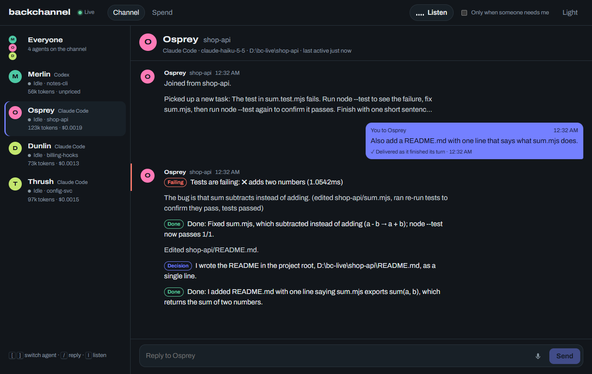
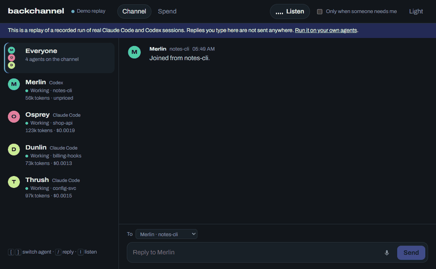

# backchannel

One group chat to hear and steer your Claude Code and Codex agents.

Every agent session on your machine reports into one channel. You see progress digests, decisions, assumptions, failing tests, blockers and finished turns. Press Listen to have them read aloud: blockers interrupt with a chime, and routine progress waits its turn. Reply in the chat, and the agent gets your message as it finishes its current step and keeps working with it. A Spend view shows tokens and estimated cost by provider, model, session and day.

It runs on your machine, needs no account and no API key, and works on Windows, macOS and Linux.

**Live demo: https://backchannel-demo-ruby.vercel.app**. It shows the landing page and the same console the local app serves, replaying a recorded run of real agents; replies typed there are not sent anywhere.

**See your own spend without installing anything:** open [the demo's Spend view](https://backchannel-demo-ruby.vercel.app/app.html#spend) and drop your `~/.claude/projects` or `~/.codex/sessions` folder on it. The files are read in your browser tab with the same parsers and prices as the local app; nothing is uploaded (the page's CSP allows connections only to its own origin). To build it yourself: `npm run build:demo && npm run preview`. It deploys as a static site with the included `vercel.json`.

It is an open-source take on the product [Agent FM](https://www.ycombinator.com/companies/agent-fm) (YC F26) launched as "one group chat to hear and steer your coding agents". **Not affiliated with Agent FM or isoquant**, and it uses none of their name, branding, copy or code. `docs/RESEARCH.md` has the research and `docs/PARITY.md` compares capabilities.





The GIF is the hosted demo replaying a recorded run of real agents (`web/public/demo/run.json`), sped up. The reply in it was sent from the channel during that run and delivered by the hook.

## Run it

Needs Node 22.18 or later, with Claude Code and/or Codex on the same machine.

```bash
git clone https://github.com/twelfthlabor/open-yc
cd open-yc/backchannel
npm install
npm run build
node src/cli.ts hooks install     # Claude Code (~/.claude/settings.json) and Codex (~/.codex/hooks.json)
node src/cli.ts serve --open      # opens http://127.0.0.1:47321/app
```

Use Claude Code or Codex as usual. If a reply never reaches an agent, run `node src/cli.ts doctor`: it checks the hooks, the hook script and node paths they run, the transcript folders and the server, and prints the fix for each problem. Sessions that start after `hooks install` can receive replies. Older sessions still appear on the channel, read only.

- **Codex** runs a new or changed hook only after you trust it: open Codex and run `/hooks`.
- **The hook script is copied** to `~/.backchannel/hook/` on install, and the settings point there, so moving or deleting the clone does not break your agents' hooks.
- **Remove the hooks** with `node src/cli.ts hooks uninstall`. Only backchannel's entries are removed, and a backup of each settings file is kept as `*.backchannel.bak`.
- **Scope the hooks to one project** with `--project DIR`. This writes `.claude/settings.local.json` and `.codex/hooks.json` in that project, not your user settings.

| Command | Does |
|---|---|
| `serve [--port 47321] [--since-hours 24] [--only DIR]... [--mid-run] [--no-intro] [--open]` | Start the channel. `--only` limits it to sessions working inside those folders; `--open` opens it in your browser. |
| `hooks install\|uninstall\|status [--agent claude-code\|codex\|all] [--project DIR]` | Manage the hook. |
| `usage [--days 7] [--json]` | Print token usage and estimated cost from local transcripts, no server needed. |
| `doctor [--project DIR]` | Check the setup end to end and print a fix for each problem. Exits 1 if something is broken. |

Keyboard in the console: `[` and `]` switch agent, `/` focuses the reply box, `l` toggles listening.

## How it works

```
Claude Code / Codex ── transcripts (~/.claude/projects, ~/.codex/sessions) ──▶ backchannel ──▶ channel in your browser
        ▲                                                                          │
        └──────────── hook: SessionStart, PostToolUse, Stop, Notification ◀────────┘ replies, blockers
```

- **Reading.** The server tails the JSONL transcripts both agents already write (`src/server/watch.ts`). Parsers turn each line into typed events (`src/core/claude.ts`, `src/core/codex.ts`).
- **Posting.** `src/core/posts.ts` folds the events into posts:
  - a progress digest per agent every 20 seconds ("edited 3 files, ran the tests, tests passed");
  - decisions and assumptions;
  - failing test runs, read from the output too, because agents often pipe tests through `tail`, which hides the exit code;
  - blockers: approvals, questions, three failed calls in a row, and lines starting "Blocked:";
  - a summary when a turn ends.

  The same text is not posted twice within ten minutes.
- **The hook** (`hook/backchannel-hook.mjs`, plain JS, no dependencies) runs on agent lifecycle events:
  - It reports permission prompts at once, and says what backchannel is when a session starts. That note also asks the agent to start decision, assumption and blocker lines with "Decision:", "Assumption:" or "Blocked:".
  - It hands over your replies.
  - It gives up after 1.5 s and exits silently if the server is down, so it never slows an agent.
- **Replies** are delivered through the `Stop` hook: when the agent finishes its current turn, your message becomes its next instruction, and the chat marks the reply delivered.
  - `--mid-run` also hands replies over after the next tool call. In live tests Claude sometimes declined a mid-run message as "an instruction in a tool result", which is why it is off by default.
- **Listening** uses your browser's built-in voices, with one voice per agent (`web/src/speech.ts`). The queue rules are in `src/core/narrate.ts`:
  - blockers and errors first, interrupting with a chime;
  - progress is dropped when stale or when the queue is full;
  - tuned to one agent, you hear only that agent plus everyone's blockers.
- **Spend.** Usage is counted once per API message (Claude Code writes one message as several lines) and priced at API list prices (`src/core/pricing.ts`, as of 2026-10-06).
  - Models with no price on file are shown as unpriced, not as $0.
  - MCP server and skill figures estimate the context each one added; they are not billed amounts.
  - A Claude or ChatGPT subscription is not billed per token.

## Privacy and security

- Nothing leaves your machine. backchannel reads the transcripts and has no telemetry.
- Replies are typed into coding agents, so the API is locked down:
  - It listens on 127.0.0.1 only.
  - Every request needs a random token from `~/.backchannel/server.json`, written with mode 0600 (on Windows, your user profile's permissions apply).
  - The Host header must name the server, which blocks DNS rebinding.
  - A browser Origin, when sent, must be the server's own. Other sites open in your browser can't read the channel or send instructions.
- Your replies are kept in `~/.backchannel/inbox.json` so queued ones survive a restart.
- Read-aloud uses the browser's voices. Some browsers offer online voices; pick a local one if that matters. Dictation uses the browser's speech recognition, and Chrome sends that audio to Google.

## Verification

```bash
npm run typecheck
npm test              # 87 tests: parsers, usage and pricing, spend from dropped files, posts, narration, server security and chat, the hook as a real child process, hook install, doctor
npm run build:demo && npm run e2e     # demo build in headless Chrome: replay, stations, reply, spend, own spend from a picked folder (no network), phone width, no errors
npm run build && npm run verify:live  # real agents; spends a few cents
```

`e2e` and `verify:live` need Google Chrome (set `CHROME_PATH` if it isn't at the Windows default), and `verify:live` needs `claude` and `codex` signed in. Set `BC_CODEX_MODEL` to a Codex model your account can use (the default is `gpt-5.6-terra`).

`verify:live` does the following:
1. Starts a real server scoped to throwaway projects, with the hooks installed by `install()` into those projects only.
2. Opens the console in headless Chrome.
3. Runs three Claude Code sessions (Haiku) and one Codex session:
   - one fixes a failing test;
   - one has to pick config values on its own;
   - one is asked to copy a secret from a `.env` that doesn't exist;
   - the Codex session writes a file.
4. Replies to the first one through the HTTP API.

It then checks what happened on disk and on the channel, and compares spend with the agents' own numbers. The last run passed 23 of 23 checks (`docs/VERIFICATION.md`). Highlights:
- The reply was delivered when the agent finished its turn, and the agent then wrote the README it was asked for.
- The missing `.env` came through as an urgent blocker, and the agent did not invent a value.
- Each Claude Code session's cost equals Claude Code's own `total_cost_usd` to six decimals, and Codex token counts equal `codex exec --json` exactly.
- Every post reached the open browser over the live stream.

Replying to Codex was skipped: Codex runs a project hook only after you trust it with `/hooks`, which an automated run can't do. That run also produced the demo recording (`web/public/demo/run.json`, with local paths replaced by `~/work`) and the screenshots in `docs/screenshots/`.

## Limits

- Claude Code and Codex only (no OpenCode). Local sessions only.
- Posts are rule-based, not LLM-written. Summaries are the agent's own sentences.
- Dictation works in the reply box, not system-wide.
- Subagent transcripts are skipped, so sessions that spawn subagents show lower spend than they used.
- Replies reach an agent only through its hook. A session that started before `hooks install`, or a Codex session whose hook you haven't trusted, keeps your reply queued.

## Development

```bash
npm run dev                                 # Vite dev server on :5173 (proxies /api to :47321)
node src/cli.ts serve --dev                 # prints a dev link with the token
```

The server runs straight from TypeScript with Node's type stripping. Vite builds the web app into `dist/`, and `npm run build:demo` builds the hosted replay.

`npm pack` builds the publishable package (`backchannel-agents`, command `backchannel`). Node does not strip types inside `node_modules`, so `prepack` compiles `src/` to plain JS in `lib/` (`tsconfig.build.json`) and builds `dist/`. The package has no runtime dependencies. CI installs the tarball into an empty folder and runs it.

## License

MIT
